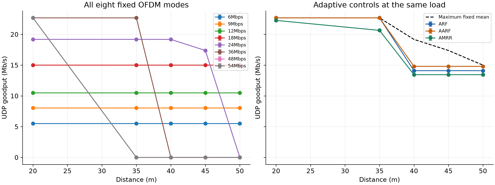
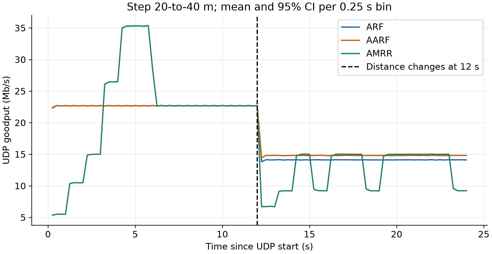

# Wi-Fi Rate Adaptation Lab

**ARF · AARF · AMRR | ns-3.45 | IEEE 802.11a**

Vì sao cùng một liên kết Wi-Fi, các thuật toán chọn tốc độ lại tạo ra goodput khác nhau? Dự án khảo sát câu hỏi này bằng máy trạng thái ARF/AARF/AMRR, trace từng quyết định và các thí nghiệm đối chứng trên ns-3.45.

Bộ mã đi cùng dữ liệu đã chạy trên Ubuntu/WSL. Người đọc có thể xem ngay kết quả, kiểm tra cấu hình nguồn và chạy lại từng nhóm thí nghiệm.

## Bắt đầu từ đâu

| Mục tiêu | Điểm bắt đầu |
|---|---|
| Cài đặt và chạy lại | [Hướng dẫn thực hành](docs/RUNNING.md) |
| Hiểu topology và chỉ số | [Thiết kế thí nghiệm](docs/METHOD.md) |
| Xem các phát hiện chính | [Đọc kết quả](docs/RESULTS.md) |
| Đối chiếu nguồn và số lần chạy | [Kiểm chứng](docs/VALIDATION.md), [SHA256SUMS.txt](SHA256SUMS.txt) |

## Một liên kết và bốn góc nhìn

```text
Nút gửi UDP CBR  ─────── Wi-Fi 802.11a ───────  Nút nhận UDP
                 ARF / AARF / AMRR / Fixed
              DATA →             ← ACK
```

- **Kênh thay đổi:** chuyển 20→40 m và 40→20 m, giữ trạng thái thuật toán xuyên suốt.
- **Chi phí RTS/CTS:** bật/tắt trên cùng tải phát và cùng khoảng cách.
- **Đường chuẩn tốc độ cố định:** quét đủ tám mode để đánh giá tập mode adaptive.
- **Độ nhạy AARF:** thay một tham số mỗi lần, so sánh với cùng baseline.

| Nhóm | Cấu hình | Số lần chạy |
|---|---|---:|
| Baseline | 5 khoảng cách × 3 thuật toán × 10 run | 150 |
| Step | 2 chiều chuyển × 3 thuật toán × 10 run | 60 |
| RTS | 5 khoảng cách × 3 thuật toán × 2 mức RTS × 10 run | 300 |
| Fixed | 5 khoảng cách × (8 fixed + 3 adaptive) × 10 run | 550 |
| Sensitivity | 12 cấu hình AARF × 2 khoảng cách × 10 run | 240 |

Bốn nhóm bổ sung gồm **1.150 mô phỏng chính**, cùng **6 smoke test**. Các quan sát adaptive được lặp giữa một số nhóm; khi gộp dữ liệu phải kiểm tra cấu hình để tránh coi chúng là mẫu độc lập.

## Kết quả nổi bật



Ở 40 m, AARF đạt khoảng **14,794 Mb/s**, tăng **4,94%** so với ARF trong tập năm mode 6/12/18/36/54 Mb/s, tải 22,68 Mb/s và cửa sổ 24 s. Khi đối chiếu đủ tám mode, fixed 24 Mb/s đạt khoảng **19,178 Mb/s**: tập tốc độ cho phép quyết định đáng kể hiệu năng quan sát.



Các đường thời gian nối kết quả tổng hợp với quá trình thích nghi. Xem thêm [cửa sổ đo, backlog và cách diễn giải độ trễ](docs/METHOD.md).

## Cấu trúc dự án

```text
baseline/        Mã và bộ phân tích của 150 lần chạy ban đầu
extended/        Mã, kiểm tra và điều phối bốn nhóm bổ sung
results/         CSV từng lần chạy, bảng tổng hợp và plan đã dùng
figures/         Biểu đồ xuất từ dữ liệu thực nghiệm
docs/            Cách chạy, phương pháp, kết quả và kiểm chứng
SHA256SUMS.txt   Dấu kiểm tra các tệp công bố
```

Các tệp C++ và script thực nghiệm giữ nguyên byte so với gói đã dùng. Tài liệu trong repo được biên soạn riêng để người đọc tái sử dụng bộ thí nghiệm. Dữ liệu công bố là CSV và plan; toàn bộ PCAP, FlowMonitor XML, log và trace từng run được tạo lại bằng hướng dẫn chạy.

## Chạy nhanh

Trong Ubuntu/WSL, sau khi có ns-3.45 và môi trường Python:

```bash
git clone https://github.com/lam261/NS3_WIFI_RATE_ADAPTATION.git
cd NS3_WIFI_RATE_ADAPTATION
source "$HOME/rr-venv/bin/activate"
python -m pip install -r requirements.txt
nsroot="$HOME/workspace/ns-allinone-3.45/ns-3.45"
python extended/install.py --ns3-root "$nsroot"
python extended/run_suite.py --ns3-root "$nsroot" --suite smoke   --first-run 11 --out "$HOME/rr-reproduce-345/00-smoke" --resume
python extended/check_smoke.py "$HOME/rr-reproduce-345/00-smoke"
```

Sau smoke, xem [thứ tự chạy đầy đủ](docs/RUNNING.md). Thời gian thực thi phụ thuộc CPU và bản build; tiến độ được in theo từng mô phỏng hoàn thành.

## Tài liệu gốc

1. M. Lacage, M. H. Manshaei, and T. Turletti, “IEEE 802.11 rate adaptation: A practical approach,” *Proc. ACM MSWiM*, 2004, pp. 126–134. [DOI](https://doi.org/10.1145/1023663.1023687).
2. M. Lacage, M. H. Manshaei, and T. Turletti, “IEEE 802.11 rate adaptation: A practical approach,” INRIA, Research Report RR-5208, 2004. [HAL](https://inria.hal.science/inria-00070784).
3. ns-3 Project, ns-3.45. [Mã nguồn phiên bản](https://gitlab.com/nsnam/ns-3-dev/-/tree/ns-3.45).

Mã nguồn theo [GPL-2.0-only](LICENSE.md). Thuật toán được cài trong manager riêng; RBAR, MADWIFI và phần cứng AR5212 là bối cảnh của công trình gốc, không phải các đối tượng đã mô phỏng trong repo này.
