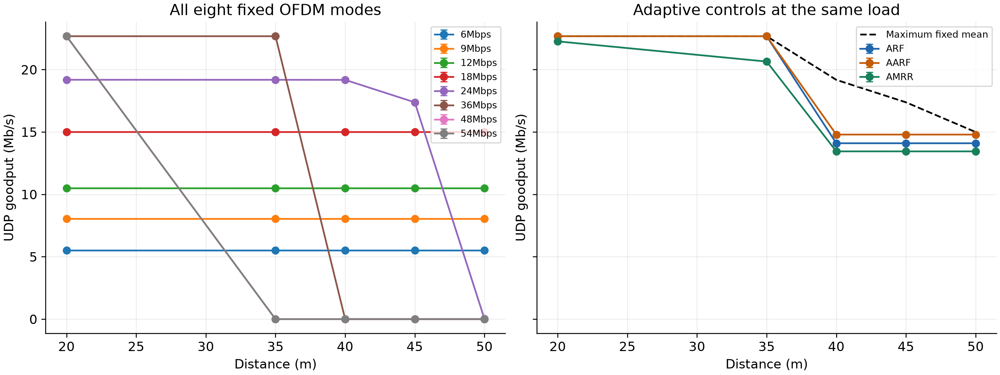
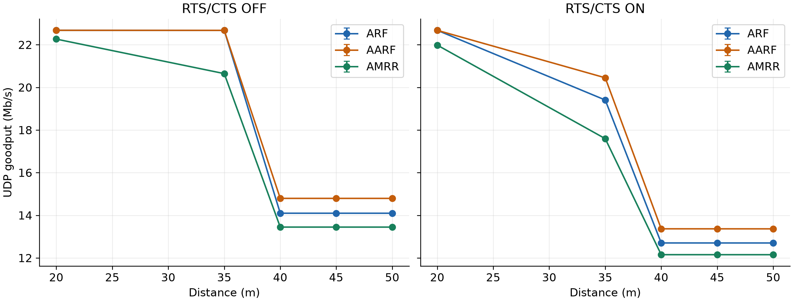
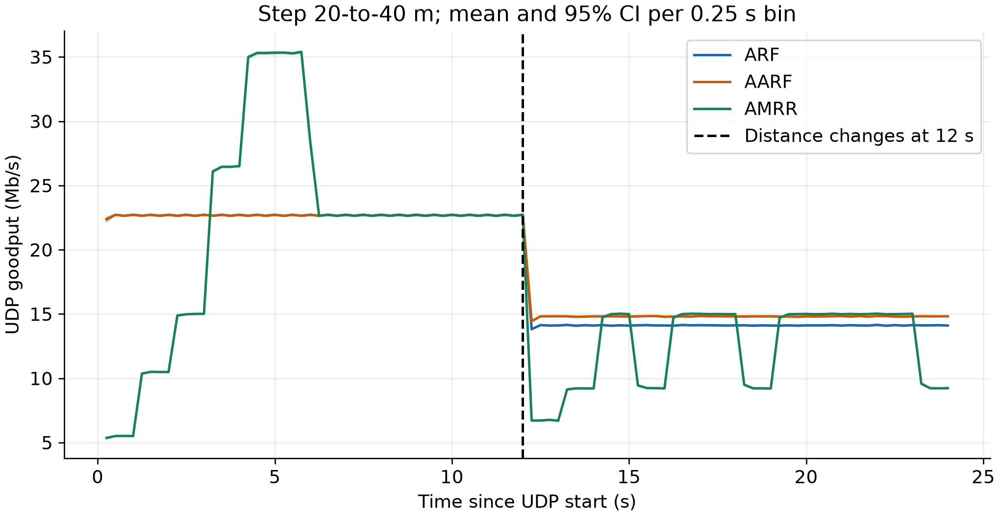
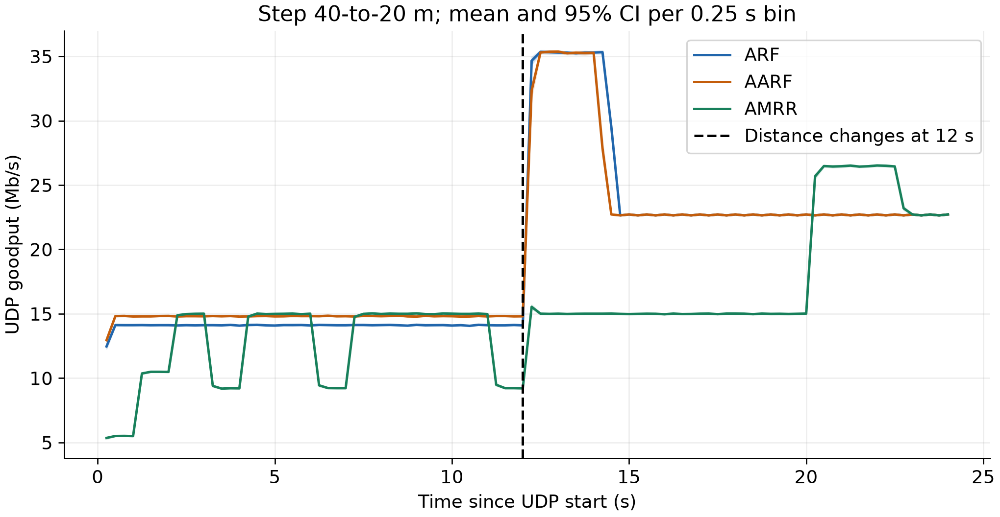
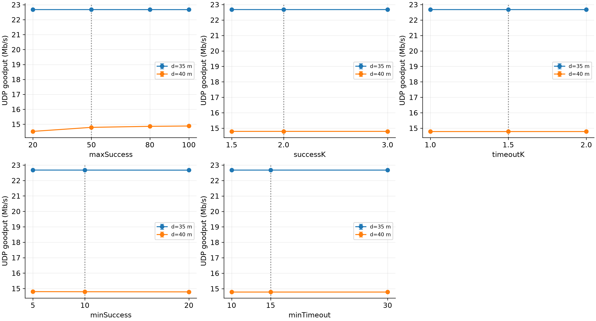

# Đọc kết quả

## Tập mode ảnh hưởng đến mốc so sánh

Ở 40 m với năm mode adaptive, AARF đạt khoảng 14,794 Mb/s và ARF 14,097 Mb/s, chênh khoảng 4,94%. AARF đạt 98,65% đường fixed tốt nhất trong năm mode, nhưng 77,14% khi xét đủ tám mode. Fixed 24 Mb/s đạt khoảng 19,178 Mb/s. Các số được đọc từ batch bổ sung run 11–20.

Nguồn: [bảng tổng hợp fixed](../results/fixed/aggregate.csv), [mode fixed tốt nhất](../results/fixed/best-fixed-mode.csv).

## RTS/CTS tạo chi phí rõ ở liên kết đơn

Ở 40 m, AARF giảm từ khoảng 14,794 xuống 13,366 Mb/s khi bật RTS/CTS cùng tải, tương ứng khoảng 9,65%. Topology một nguồn gửi cho phép quan sát chi phí cơ chế này; môi trường có hidden node cần một topology riêng.

Nguồn: [chênh lệch bật trừ tắt](../results/rts/rts-on-minus-off.csv).

## Diễn biến theo thời gian làm rõ thích nghi

Hai chiều chuyển dùng cùng thời điểm đổi kênh: 12 s kể từ khi UDP bắt đầu, tức t tuyệt đối 14 s. Các pha trước chuyển, hai giây đầu sau chuyển và bốn giây cuối được lưu trong [step-phases-aggregate.csv](../results/step/step-phases-aggregate.csv). Kết hợp với trace rate để giải thích chênh lệch và hiện tượng giải phóng gói tồn.

## Độ nhạy AARF

Smax có ảnh hưởng lớn nhất trong các mức đã quét ở 40 m. Một số chênh lệch nhỏ có CI hẹp nhưng kích thước hiệu ứng rất nhỏ; cần nêu cả Mb/s và phần trăm khi đánh giá tác động. Mức baseline là Smin=10, Smax=50, Tmin=15, Ks=2, Kt=1,5.

Nguồn: [bảng chênh so baseline](../results/sensitivity/sensitivity-minus-baseline.csv).

## Dữ liệu đi kèm

`all-runs-verified.csv` giữ một hàng mỗi lần chạy; `aggregate.csv` chứa mean, số mẫu và CI. Các `plan.json` trong từng nhóm lưu tham số và hash nguồn. Batch baseline có [150 dòng kết quả](../results/baseline/all-runs.csv). Repo chỉ công bố các bảng/biểu đồ được chọn; log, PCAP và trace chi tiết được tạo bằng quy trình chạy lại.
